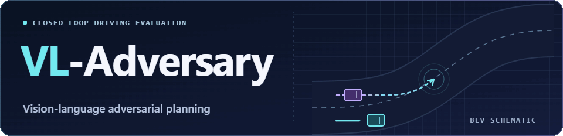
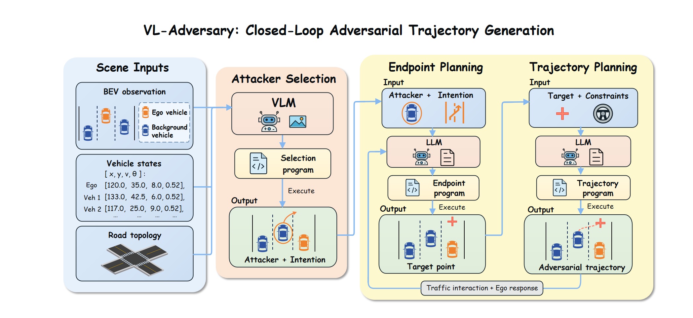
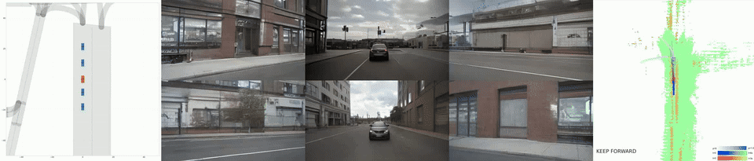
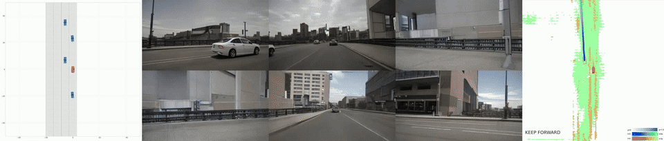
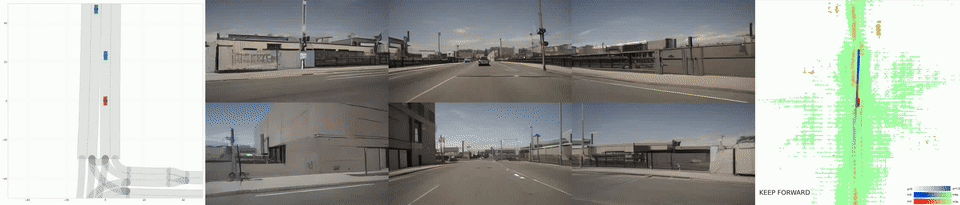

<a name="top"></a>
<h1 align="center">
  <picture>
    <source media="(prefers-reduced-motion: reduce)" srcset="docs/images/project-header.svg">
    
  </picture>
</h1>

<p align="center"><strong>Vision-Language-Driven Safety-Critical Trajectory Generation for Autonomous Driving</strong></p>

<p align="center">
  <a href="#method"></a>
  <a href="#video-gallery"></a>
  <a href="#quick-start"></a>
  <a href="#code-layout"></a>
</p>

<p align="center">
  <a href="docs/QUICKSTART.md">Setup Guide</a> &nbsp;·&nbsp;
  <a href="docs/QUICKSTART_CN.md">中文指南</a> &nbsp;·&nbsp;
  <a href="#license-and-credits">Credits</a>
</p>

VL-Adversary generates safety-critical interactions for closed-loop autonomous driving evaluation. A vision-language model selects an adversarial vehicle and maneuver from the scene, and a language model writes executable planning programs that update the vehicle's motion as the ego vehicle responds.

## Method



*The framework connects multimodal attacker selection and two-stage executable planning with feedback from the ego vehicle.*

1. **Observe.** LimSim provides a bird's-eye-view (BEV) image, vehicle states, and road topology.
2. **Select.** The VLM chooses a surrounding vehicle and an attack intention.
3. **Plan.** The LLM generates an endpoint function followed by a trajectory function. The prompts specify road geometry, kinematics, and motion continuity.
4. **Interact.** TrafficManager executes the generated trajectory. DreamForge renders six camera views for UniAD.
5. **Update.** The ego vehicle's response and the latest scene state guide subsequent endpoint and trajectory updates.

Prompted constraints and runtime checks support trajectory feasibility. Feasibility can vary by model output.

<a name="demonstrations"></a>

## Video Gallery

Explore three adversarial maneuvers from the closed-loop simulator. Each case has an animated preview and an MP4 file.

<p>
  <a href="#brake-check"><kbd>01</kbd> Brake-check</a> &nbsp;·&nbsp;
  <a href="#cut-in"><kbd>02</kbd> Cut-in</a> &nbsp;·&nbsp;
  <a href="#opposite-direction-intrusion"><kbd>03</kbd> Opposite-direction intrusion</a>
</p>

### Brake-check

The adversarial vehicle brakes ahead of the ego vehicle in the same lane. [Brake-check MP4](docs/videos/brake_check_007.mp4)



### Cut-in

The adversarial vehicle moves from a neighboring lane into the ego vehicle's path. [Cut-in MP4](docs/videos/cut_in_003.mp4)



### Opposite-direction intrusion

An oncoming adversarial vehicle enters the ego vehicle's lane. [Intrusion MP4](docs/videos/opposite_direction_intrusion_002.mp4)



<a name="running"></a>

## Quick Start

[English setup guide](docs/QUICKSTART.md) · [中文运行指南](docs/QUICKSTART_CN.md) · [Attack configuration](TrafficManager/config-attack.yaml)

Follow the setup guide to prepare Linux/WSL, SUMO, and model weights, then start the DreamForge and UniAD services. Activate the simulation environment, set `DASHSCOPE_API_KEY`, and run this from the repository root.

```bash
export PYTHONPATH="$PWD${PYTHONPATH:+:$PYTHONPATH}"
python -u TrafficManager/batch_test.py --mode attack --per-type-limit 1
```

This command runs one initial scene per category from the included Boston-Seaport collection, makes real model requests, and writes batch outputs under `test_results/attack/`. Use the [single-scene entry point](TrafficManager/sim_manager_t_attack.py) to run an individual scene.

The default configuration uses `qwen3-vl-plus` for selection and `qwen-coder-plus-1106` for endpoint and trajectory generation. Model availability depends on the API provider and account.

## Code layout

| Directory | Purpose |
| --- | --- |
| [Attack framework](TrafficManager/attack_framework/) | Scene analysis, target selection, two-stage planning, and trajectory injection |
| [Scenario inputs](TrafficManager/networkFiles/) | Road networks and initial traffic configurations |
| [DreamForge](WorldDreamer/DreamForge/) | Multi-view generative rendering service |
| [UniAD](DrivingAgents/UniAD/) | Ego driving model and its service |
| [Documentation](docs/) | Setup guides and packaging notes |

The public snapshot contains source code and scenario inputs. Model checkpoints, datasets, API credentials, and experiment outputs are not included. This repository does not yet provide a verified reproduction of the paper's quantitative tables.

## License and credits

See [LICENSE.txt](LICENSE.txt) and [third-party notices](THIRD_PARTY_NOTICES.md). Bundled components retain their original licenses and notices. VL-Adversary describes the adversarial generation method; the simulation, rendering, and driving components are credited separately.

[↑ Back to navigation](#top)
