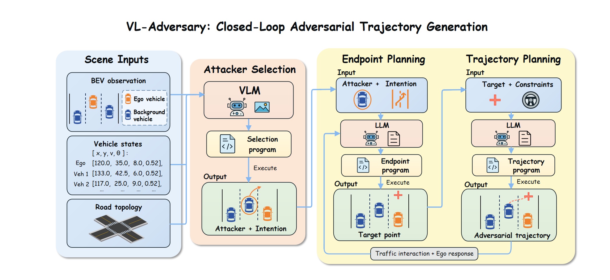
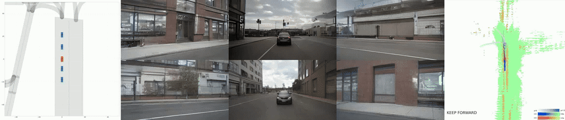
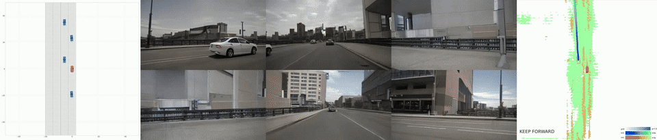
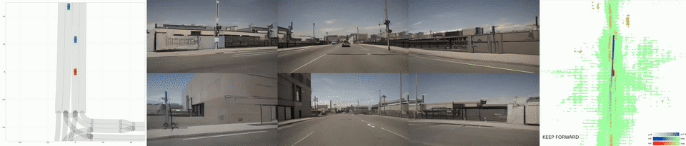

# VL-Adversary 简明运行指南

本项目使用 BEV 图像、车辆状态和道路拓扑选择对抗车辆及攻击意图，再通过两阶段语言模型生成危险终点和轨迹程序。在闭环仿真中，选定车辆的轨迹随交通状态和自车响应更新。支持前车制动、相邻车辆切入和对向车辆侵入三类攻击。



*方法框架：多模态对抗车辆选择、两阶段可执行程序规划，以及基于自车响应的闭环轨迹更新。*

## 视频展示

### 前车制动



### 相邻车辆切入



### 对向车辆侵入



## 环境与外部资源

- 仿真端使用 Linux 或 WSL，准备 SUMO、图形运行环境，以及 `TrafficManager/requirements.txt` 中的依赖。原依赖基于 Python 3.8、PyTorch 1.9.1 和 MMCV 1.4.0，安装时需要匹配 CUDA 版本。
- DreamForge 与 UniAD 分别使用各自环境，不要把所有依赖混装。参阅 [DreamForge 安装说明](../WorldDreamer/DreamForge/doc/INSTALL.md)、[数据和权重准备](../WorldDreamer/DreamForge/doc/GETTING_STARTED.md)及 [UniAD 说明](../DrivingAgents/UniAD/README.md)。
- 仓库不附带模型权重、完整数据集或 API 密钥。DreamForge 需要其权重及 `data/canbus_infos_trainval.pkl` 等数据；UniAD 需要自身权重、CAMixerSR 代码和对应权重。
- `TrafficManager/data/data_template.pth` 已从仓库内的 UniAD 模板补齐，它是运行输入模板，不是模型权重。

## 配置与启动

以下仿真命令均在 `VL-Adversary` 根目录执行：

```bash
conda create -n vl_adversary python=3.8
conda activate vl_adversary
pip install -r TrafficManager/requirements.txt
export PYTHONPATH="$PWD${PYTHONPATH:+:$PYTHONPATH}"
```

单独安装 SUMO，确保命令可用，并按安装位置设置 `SUMO_HOME`。

在 DreamForge 环境中，进入 `WorldDreamer/DreamForge` 后启动：

```bash
python tools/run_fastapi.py --model_single ./pretrained/dreamforge-s --model ./pretrained/dreamforge-t --host 127.0.0.1 --port 11000
```

闭环运行不要使用 `--debug`，该模式读取数据集样本而非仿真输入。

在 UniAD 环境中，进入 `DrivingAgents/UniAD` 后启动：

```bash
python demo/uniad_fast_api.py --checkpoint ckpts/uniad_base_e2e.pth --host 127.0.0.1 --port 11001
```

启动前还需准备 `ckpts/CAMixerSRx4_DF.pth` 等组件资源。若部署在远程 GPU 服务器，请将服务端口转发到仿真机器，或修改 `TrafficManager/config-attack.yaml` 中的 `servers` 地址。

默认配置使用 `qwen3-vl-plus` 选择车辆和意图，使用 `qwen-coder-plus-1106` 生成终点和轨迹，服务为阿里云兼容接口。在仿真终端设置 `DASHSCOPE_API_KEY`，不要将密钥写入配置或提交到仓库。Bash 中可隐藏输入：

```bash
read -rsp 'Model API key: ' DASHSCOPE_API_KEY
echo
export DASHSCOPE_API_KEY
```

`simulation.use_agent_path: true` 表示使用 UniAD 规划反馈。选择器默认沿用 `llm` 的连接配置；改用另一家模型服务时，为选择器单独设置 `api_base` 和 `api_key_env`。模型是否可调用取决于服务商和账户权限。

## 基本运行入口

启动服务并返回仿真环境后，从项目根目录执行每类一个场景的小批次：

```bash
python -u TrafficManager/batch_test.py --mode attack --per-type-limit 1
```

单场景运行：

```bash
python -u TrafficManager/sim_manager_t_attack.py \
  --config TrafficManager/config-attack.yaml \
  --scene_name brake_check_001 \
  --sumo_cfg networkFiles/boston-seaport/scenarios_diverse_3types/brake_check_001/brake_check_001.sumocfg \
  --sumo_rou networkFiles/boston-seaport/scenarios_diverse_3types/brake_check_001/brake_check_001.rou.xml
```

场景名称只描述初始配置，不强制指定模型选中的车辆或攻击类型。批次结果位于 `test_results/attack/`，单场景输出位于 `results/`。这些命令会实际调用模型并启动仿真，需要 GPU 服务就绪。

当前公开副本以方法和运行入口介绍为主，未进行全新 GPU 环境安装或完整闭环复跑，也暂不提供论文实验表格的逐项复现说明。更多配置细节见 [英文指南](QUICKSTART.md)。
